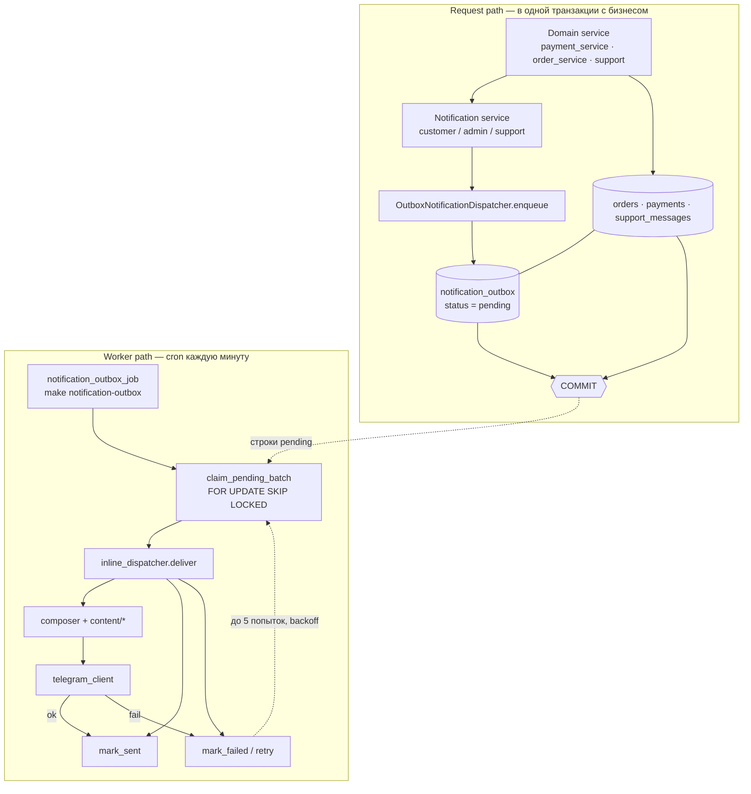
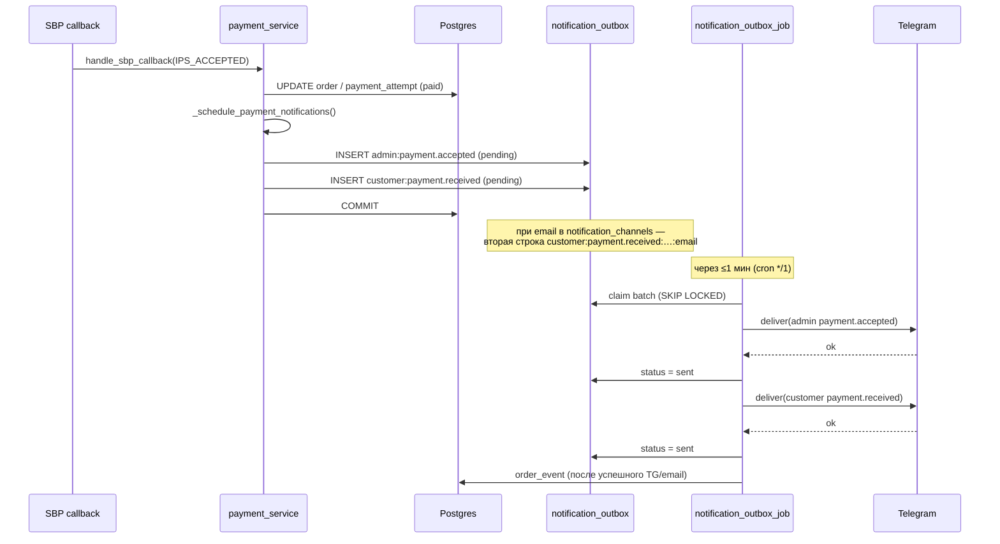
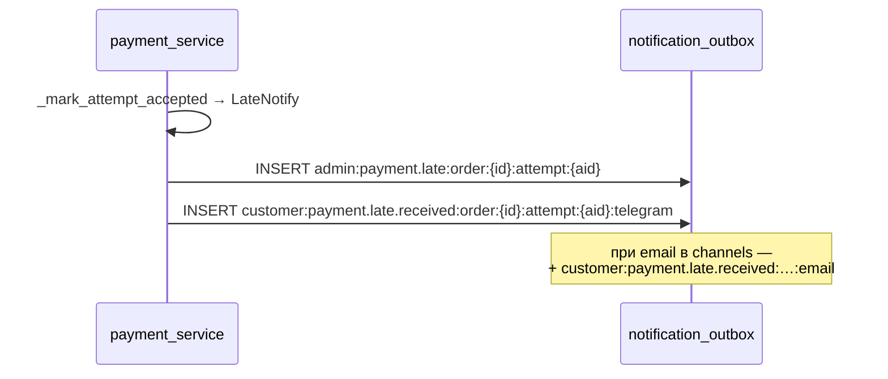
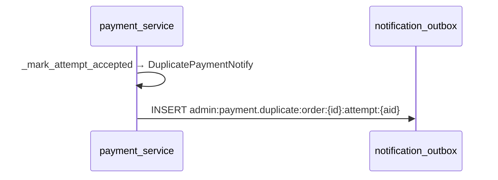
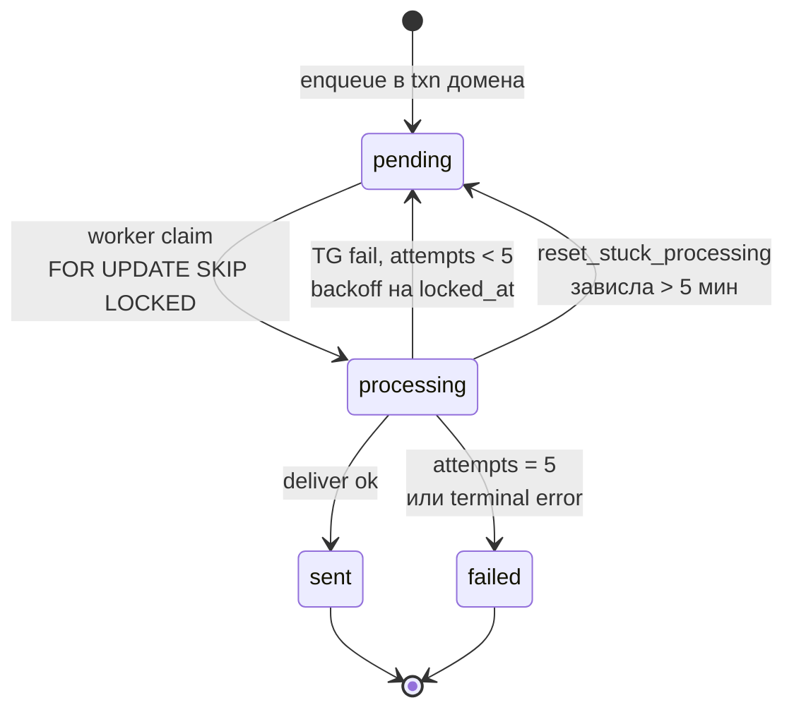
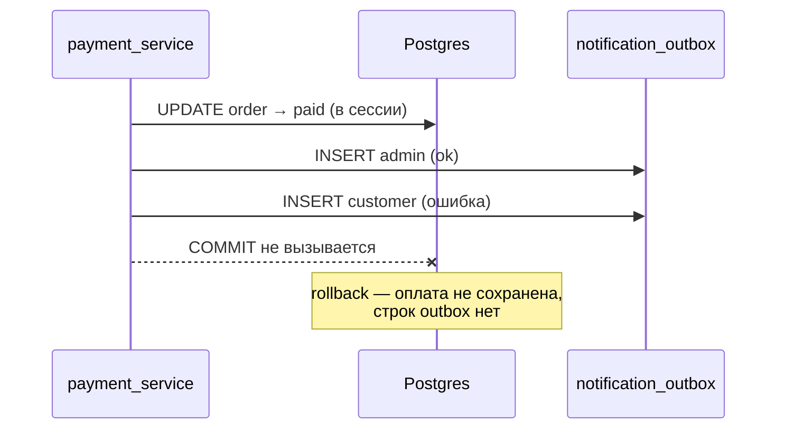
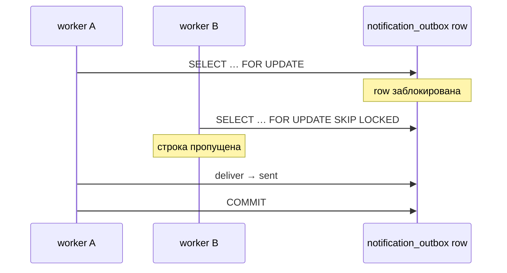

# Как работают TG-уведомления через outbox

Визуальная схема transactional outbox: бизнес-изменение и intent уведомления
коммитятся вместе; Telegram вызывается отдельным worker'ом.


---

## Два пути: запрос и worker



**Prod:** `NOTIFICATION_MODE=outbox` — в HTTP/callback пути нет вызова Telegram.
**Local debug:** `NOTIFICATION_INLINE=1` — сразу `deliver()`, без записи в outbox.

---

## Пример: callback SBP «оплата принята» (обычный путь)

Один `COMMIT` фиксирует и статус оплаты, и две строки outbox (админ + клиент).



## Пример: late payment (`status == cancelled`)

Заказ уже отменён, пришла первая успешная оплата. Клиенту **не** шлётся `payment.received`
(ни TG, ни email).



Текст для email — тот же `payment.late.received`, формат plain (`compose_email_notification`).

Journey payment stage учитывает оба шаблона: `payment.received` и `payment.late.received`
(TG и Email по `customer_notified`).

## Пример: duplicate payment (вторая успешная попытка)

Заказ уже оплачен другой попыткой. Клиенту **ничего**; админу критический TG.



Idempotency per attempt: повторный callback той же попытки не создаёт вторую строку
(`mark_payment_attempt_paid_if_unpaid` + `UNIQUE(idempotency_key)`).

**Dedup:** повторный callback с тем же событием → `UNIQUE(idempotency_key)` не даёт
вторую строку outbox.

---

## Жизненный цикл строки outbox



| Статус | Кто меняет | Смысл |
|--------|------------|-------|
| `pending` | domain insert / retry | ждёт worker |
| `processing` | worker claim | доставка в процессе |
| `sent` | worker | TG доставлен |
| `failed` | worker | исчерпаны попытки |

---

## Если outbox не записался — откат всей транзакции

Scheduling уведомления не оборачивается в `try/except`: сбой INSERT в outbox
отменяет и изменение оплаты.



---

## Несколько worker'ов — без двойной доставки



Параллельные cron-запуски или два инстанса API не шлют одно и то же сообщение дважды:
каждая строка забирается одним worker'ом.

---

## Что проверяем тестами

| Сценарий | Где |
|----------|-----|
| dedup по `idempotency_key` | `tests/integration/test_notification_outbox.py` |
| `SKIP LOCKED` при параллельном claim | там же |
| `handle_sbp_callback` → оплата + 2 outbox (обычный путь) | там же |
| late payment → `payment.late` + `payment.late.received` | `tests/unit/test_unpaid_order_lifecycle.py` |
| duplicate → `payment.duplicate` admin only | `tests/unit/test_payment_attempts.py` |
| сбой outbox → rollback оплаты | `tests/integration/test_notification_outbox.py` |
| 5 retry → `failed` | там же |

```bash
make test-integration   # PostgreSQL
make notification-outbox   # ручной прогон worker локально
```
