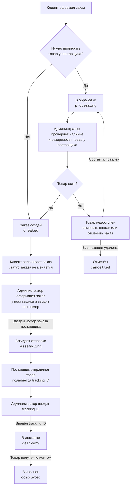
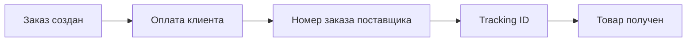

# Как заказ движется по статусам

Визуальная схема для ручной работы с заказом. Здесь показано, что происходит
с товаром, что делает администратор и какой статус видит клиент.

Схема с Telegram и ЛК по шагам:
[`order-lifecycle-notifications.md`](order-lifecycle-notifications.md).

## Основной путь заказа



## Коротко по шагам

| Шаг | Кто действует | Что происходит | Статус после действия |
|-----|---------------|-----------------|------------------------|
| 1 | Система | Создаёт заказ | `created` или `processing` |
| 2 | Администратор | Проверяет и резервирует товар у поставщика | `created`, если наличие подтверждено |
| 3 | Клиент | Оплачивает заказ | Остаётся `created` |
| 4 | Администратор | Оформляет заказ у поставщика и вводит его номер | `assembling` — «Ожидает отправки» |
| 5 | Поставщик | Отправляет товар, появляется tracking ID | Пока остаётся `assembling` |
| 6 | Администратор | Вводит tracking ID | `delivery` — «В доставке» |
| 7 | Администратор | Подтверждает получение клиентом | `completed` — «Выполнен» |

## Какие данные появляются по пути



- Номер заказа поставщика появляется, когда администратор оформил заказ у
  поставщика.
- Tracking ID появляется позже, когда поставщик передал посылку перевозчику.
- Сейчас tracking ID вводится вручную. Позже его сможет получать парсер.
- Оплата клиента хранится отдельно и сама по себе не меняет `order.status`.

## Ошибка при обработке

Из рабочих статусов заказ можно перевести в `failed` — «Ошибка при обработке
заказа». После устранения ошибки заказ возвращается на тот этап, где возникла
ошибка: `created`, `processing`, `assembling` или `delivery`.

Точные правила переходов и проверки availability описаны в
[`order-status-scenarios.md`](order-status-scenarios.md).

## Локальный прогон (dev)

Checkout — на storefront. Дальше make-команды из `local_scripts/Makefile`:

```bash
make -f local_scripts/Makefile order-cycle-guide ORDER_ID=<id>
make -f local_scripts/Makefile order-verify-cycle ORDER_ID=<id>
```

ParcelLab-only: `tracking-parcellab-stage` по этапам до `delivered`, затем ручной
`completed` в админке (или `order-finalize` локально).
