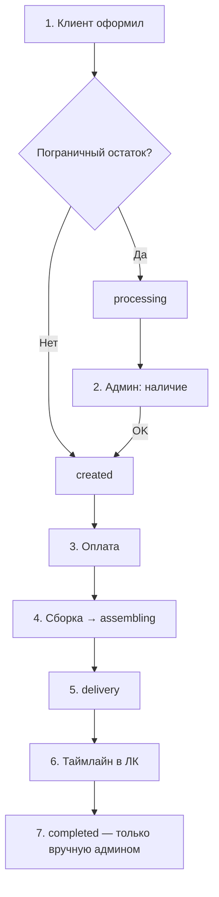
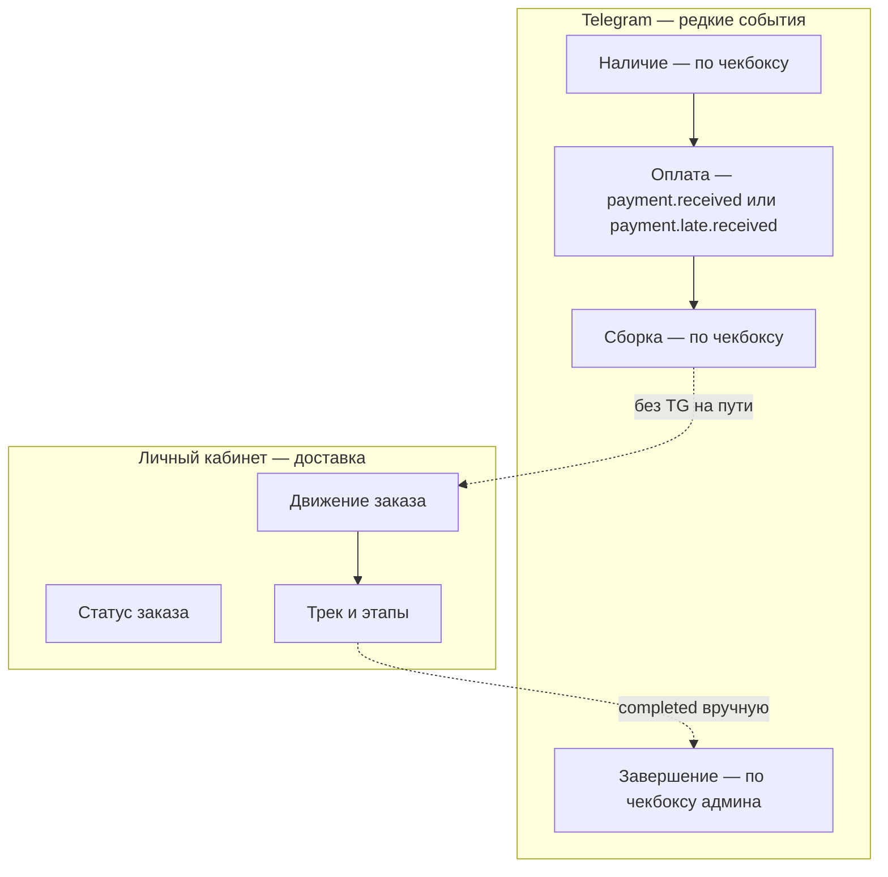

# Жизненный цикл заказа: шаги и уведомления

Справочник по **каналам уведомлений** (Telegram, Email, личный кабинет) на каждом шаге
карты заказа в админке.

См. также:

- [`order-fulfillment-flow.md`](order-fulfillment-flow.md) — путь товара без уведомлений;
- [`order-status-scenarios.md`](order-status-scenarios.md) — правила статусов, availability, terminal UX;

---

## Как читать этот документ

| Метка | Значение |
|-------|----------|
| **Сейчас** | Реализовано в коде на dev |
| **Цель** | Желаемое поведение, ещё не включено или включено частично |

---

## Карта заказа (шаги в админке)

| № | Шаг | Что меняется | TG (**сейчас**) | Email (**сейчас**) | ЛК (**сейчас**) |
|---|-----|--------------|-----------------|--------------------|-----------------|
| 1 | Клиент оформил | `created` или `processing` | если выбран канал | если выбран канал | заказ в списке |
| 2 | Наличие | `availability_confirmation_status` | да, если канал + чекбокс | да, если канал + чекбокс | бейдж проверки |
| 3 | Оплата | `payment_paid_at` | `payment.received` или `payment.late.received` | тот же template, если email в `notification_channels` | «Оплачено» или `late_paid_after_cancel` |
| 4 | Сборка | `created` → `assembling` | да, если канал + чекбокс | да, если канал + чекбокс | этап «Сборка» |
| 5 | Доставка | `assembling` → `delivery` | **нет** | **нет** | «В доставке», трек |
| 6 | Движение | статус `delivery` | **нет** | **нет** | таймлайн ParcelLab / DHL |
| 7 | Выполнен | `delivery` → `completed` | если канал + чекбокс | если канал + чекбокс | «Выполнен» |

**TG админу (сейчас):** отдельное сообщение в группу заказов при terminal `delivered` от
ParcelLab/DHL — «возможно, доставлен»; при ручном `completed` — «завершён администратором».
См. decision delivered admin alert.

---

## Сейчас: основной путь

### Шаг 7 — важно

**Сейчас:**

- Автоматический переход `delivery` → `completed` по `delivered` от трекера **не реализован**.
- Sync ParcelLab/DHL обновляет таймлайн и шлёт **админу** delivered alert; статус заказа
  остаётся `delivery`.
- Переход в `completed` — **ручной** (`POST …/delivery` или смена статуса в админке).
- TG **клиенту** при завершении — **только если** админ включил «Уведомить клиента»
  (`notify_customer=1`). Без чекбокса — только событие в истории, без TG.

**Цель (не реализовано):**

- Авто-`completed` при первом надёжном `delivered` от DHL/ParcelLab.
- Обязательное TG клиенту «Спасибо + поддержка» один раз на заказ при завершении.

---

## Сейчас: два канала для клиента

---

## Сейчас: чекбокс «Уведомить клиента»

| Действие | TG клиенту? |
|----------|-------------|
| Подтверждение / отказ по наличию | да, если чекбокс |
| Изменение состава (до оплаты) | да, если чекбокс |
| Передать в сборку | да, если чекбокс |
| Смена статуса (не terminal) | да, если чекбокс |
| Передать в доставку | **нет** |
| Завершить заказ (`completed`) | **да, только если** чекбокс |
| Sync трекинга / движение | **нет** |

Terminal заказы (`completed`, `cancelled`, `failed`) — формы статуса и «Написать клиенту»
заблокированы. См. [`order-status-scenarios.md`](order-status-scenarios.md).

---

## Сейчас: оплата — обычная, поздняя, duplicate

| Сценарий | Условие | Клиент TG | Клиент Email | Админ TG | `payment_state` в ЛК |
|----------|---------|-----------|--------------|----------|---------------------|
| Обычная оплата | `status != cancelled` | `payment.received` | `payment.received` (тот же текст, plain) | `payment.accepted` | `paid` |
| Late payment | `status == cancelled`, первая успешная оплата | `payment.late.received` | `payment.late.received` (тот же текст, plain) | `payment.late` | `late_paid_after_cancel` |
| Duplicate payment | заказ уже оплачен другой попыткой | **нет** | **нет** | `payment.duplicate` | без изменения |

**Email:** отдельного шаблона нет — `expand_customer_dispatch` дублирует CUSTOMER dispatch
по `order.notification_channels`. Если на checkout выбран email, в outbox две строки:
`…:telegram` и `…:email` с одним `template` и разными idempotency suffix.

**Late payment:** `cancellation_reason` не влияет. Обычные `payment.accepted` / `payment.received`
**не** отправляются (ни TG, ни email). Legacy-имена флагов (`late_payment_after_auto_cancel`,
`late_paid_after_cancel`) сохранены — см. decision.

**Journey:** этап «Оплата» учитывает оба шаблона (`payment.received`, `payment.late.received`)
для TG и Email по событию `customer_notified`. Outbox-key late payment per attempt
(`…:attempt:{aid}:email`) не входит в `all_customer_outbox_keys` — до записи события
бейдж EM может дольше показывать «…» (как у `payment.failed`).

**Duplicate:** idempotency per attempt (`admin:payment.duplicate:order:{id}:attempt:{aid}`).
Повторный callback той же попытки не создаёт вторую строку outbox. Клиенту (TG/email) **ничего**.

---

## Цель: автоматизация (не в коде)

| Переход | Целевое поведение |
|---------|-------------------|
| `delivery` → `completed` | авто при terminal `delivered` от трекера |
| TG клиенту при завершении | всегда, без чекбокса |
| Один чекбокс на карточке | вместо дублирования на каждой форме |

---

## Что не делаем (ни сейчас, ни в цели)

- Telegram при каждом этапе доставки (`in_transit`, `last_mile`, …).
- Telegram клиенту при переходе в статус `delivery`.
- Завершение заказа только по «в пути» без этапа **delivered** от трекера (в целевой модели).
