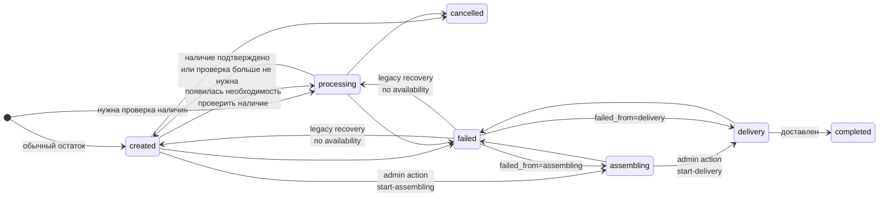

# Статусы заказа, оплаты и наличия

Справочник для клиентского UI, админки и ручной проверки заказа.

Визуальный путь товара от оформления до получения:
[`order-fulfillment-flow.md`](order-fulfillment-flow.md).

Уведомления клиенту (TG vs ЛК) по шагам:
[`order-lifecycle-notifications.md`](order-lifecycle-notifications.md).

См. также:

---

## Общая схема статусов заказа

Переходы `created ↔ processing` происходят автоматически после изменения
`availability_confirmation_status`. Вручную выбирать их в админке нельзя.

Оплата клиента **не меняет** `order.status`: после оплаты заказ остаётся в
`created` до передачи в сборку.

## Что означает `order.status`

| `order.status` | Смысл | Что видит администратор |
|----------------|-------|--------------------------|
| `created` | Наличие OK; ждёт оплаты или оформления у поставщика | Оплата доступна; после оплаты — форма «Передать в сборку» |
| `processing` | Идёт проверка наличия | Нужно подтвердить наличие или изменить состав |
| `assembling` | Клиент оплатил; заказ оформлен у поставщика | Форма «Передать в доставку» (tracking обязателен) или `failed` через select |
| `delivery` | Отправлен клиенту | Можно завершить доставку или отметить ошибку |
| `completed` | Заказ доставлен | Терминальный статус |
| `cancelled` | Заказ отменён | Терминальный статус |
| `failed` | Ошибка при обработке заказа | Отмена или восстановление по `failed_from_status` / availability |

Причины `failed` пока не классифицированы. Конкретная причина может быть указана
в событии заказа.

## Допустимые пары status + availability

| Сценарий | `order.status` | `availability` | Оплата |
|----------|----------------|----------------|--------|
| Обычный checkout | `created` | `not_required` | Доступна |
| Checkout с пограничным остатком | `processing` | `pending` | Недоступна |
| Администратор подтвердил наличие | `created` | `confirmed` | Доступна |
| Администратор отметил товар недоступным | `processing` | `unavailable` | Недоступна |
| Проблемную позицию удалили, другие остались | `created` | `confirmed` | Доступна |
| Удалили все позиции | `cancelled` | `unavailable` | Недоступна |

Пары `created + pending` и `processing + confirmed|not_required` считаются
несогласованными. Sync должен привести их к правильному `order.status`.

---

## Статусы оплаты (`payment_state` + `payment_label`)

| `payment_state` | `payment_label` (клиент) | Кнопка / пояснение |
|-----------------|--------------------------|-------------------|
| `not_started` | Можно оплатить | «Оплатить» |
| `initializing` | Создаём оплату | «Продолжить оплату» |
| `waiting` | Ожидает оплаты | «Продолжить оплату» |
| `failed` | Оплата не прошла | «Повторить оплату» |
| `paid` | Оплачено | — |
| `exhausted` | Лимит попыток исчерпан | текст, без кнопки |
| `late_paid_after_cancel` | Оплачено (оранжевый бейдж) | «Заказ проходит проверку.» |

**Late payment:** любая успешная оплата при `order.status == cancelled` (причина отмены не важна).
Legacy-флаги `late_payment_after_auto_cancel` / `late_paid_after_cancel` сохраняют старые имена, но означают «оплата после любой отмены».

---

## Отображение проверки наличия в ЛК

| Место в карточке | Текст |
|------------------|-------|
| `payment_label` / бейдж в шапке | Проверяем наличие |
| Строка «Оплата» | Проверяем наличие |
| Над кнопкой | Оплата станет доступна после проверки. |
| Кнопка | Оплатить (disabled) |

`payment_allowed = false`. Срок оплаты в шапке не показывается.

---

## Прочее в карточке

| Элемент | Поведение |
|---------|-----------|
| Срок оплаты | «Оплатить до ДД.ММ.ГГ ЧЧ:ММ» — без «мск» |
| Итого | цвет `var(--sp-text-primary)` |
| Timeout-cancelled unpaid | заказ скрыт из списка ЛК |
| `unavailable` | «Часть товаров недоступна.» (`availability_message_ru`) |

---

## Админка

| Элемент | Текст / поведение |
|---------|-------------------|
| Availability pending | «Ожидает подтверждения» (`admin_labels.py`) |
| Late pay после auto-cancel | alert в карточке заказа |
| Duplicate payment | TG «КРИТИЧНО: повторная успешная оплата» (`payment.duplicate`) |
| `payment_due_at_display` | с суффиксом «мск» |
| `created`, заказ оплачен, availability OK | Форма «Передать в сборку» (`POST …/start-assembling`) |
| Select статуса | `assembling` из `created` недоступен; `delivery` из `created` недоступен |
| `assembling` | Форма «Передать в доставку» (`POST …/start-delivery`, tracking обязателен); через select — только `failed` |
| `processing` | Ручной переход в `created` или `delivery` недоступен |

---

## Terminal admin UX (`completed`, `cancelled`, `failed`)

| Статус | Карточка «Статус заказа» | «Написать клиенту» | Состав заказа |
|--------|--------------------------|--------------------|---------------|
| `completed` | readonly, дата события | скрыта | readonly |
| `cancelled` | readonly | скрыта | readonly |
| `failed` | форма (можно выйти из failed) | скрыта | readonly |

**Backend:** terminal-заказы нельзя повторно уведомлять через формы «Обновить статус» /
«Написать клиенту» с тем же статусом (`_reject_repeat_status_customer_notify`,
`send_customer_telegram_message`). POST с `notify_customer=1` на `cancelled` / `completed`
без смены статуса → ошибка.

`failed` — не полностью terminal: допустимы переходы `failed` → `assembling` /
`delivery` / `cancelled` по `failed_from_status`.

---

## Supplier availability snapshot

| Элемент | Поведение |
|---------|-----------|
| Поле | `orders.supplier_availability_json` |
| Trigger | RQ job после checkout с `availability=pending` |
| TTL | 5 мин (`SUPPLIER_AVAILABILITY_SNAPSHOT_TTL_MINUTES`) |
| `composition_hash` | хэш состава заказа; при смене позиций snapshot считается устаревшим |
| Confirm / reject | перед решением проверяются TTL и `composition_hash` |
| Verdict `ready_for_admin` | все варианты найдены, qty достаточно |
| Verdict `manual_review` | CAPTCHA, login, variant не найден, qty unknown/мало |
| Verdict `failed` | полный сбой проверки |
| Повторная проверка | `POST …/availability/recheck` — новый job; admin TG + карточка |
| Kill switch | `SUPPLIER_AVAILABILITY_ENABLED=false` |

Admin UI показывает блок «Автопроверка TP» на карточке заказа; TG в группу заказов —
шаблон `availability.supplier_check`.

---

## Короткая ручная проверка

1. Обычный товар → `created + not_required`, оплата доступна.
2. Пограничный остаток → `processing + pending`, оплата недоступна.
3. Подтвердить наличие → `created + confirmed`, одно событие
   `processing → created`.
4. Отметить товар недоступным → `processing + unavailable`.
5. Удалить единственную проблемную позицию → `cancelled + unavailable`.
6. Неоплаченный `created` нельзя передать в сборку.
7. Оплаченный `created + confirmed|not_required` → start-assembling → `assembling`.
8. В `assembling` → start-delivery (tracking) → `delivery` → `completed`.
