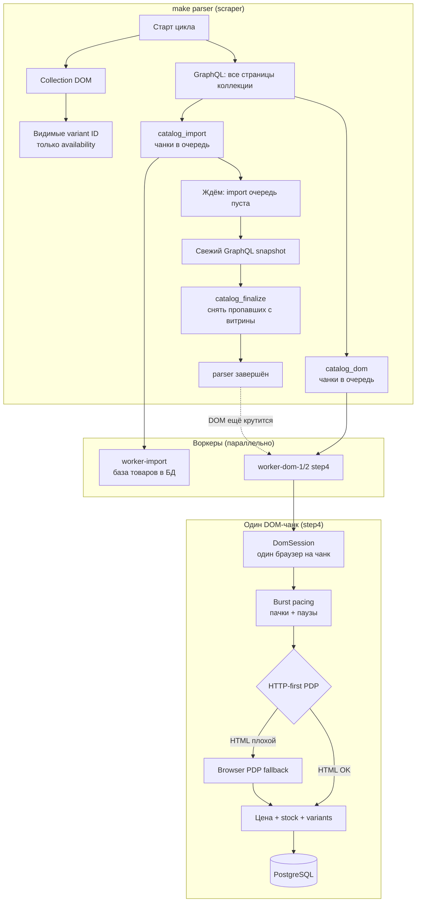

# `src/scraper` technical notes

Техническая памятка по scraper-пакету: структура, назначение файлов, команды,
env-настройки и эксплуатация.

**Архитектура для новых разработчиков (15–20 мин):** [`SCRAPER_ARCHITECTURE.md`](SCRAPER_ARCHITECTURE.md) —
flow, recovery, anti-patterns, debugging, карта зависимостей, TL;DR.

## Pipeline

Подробная схема step4 — в конце файла, раздел [Pipeline (step4)](#pipeline-step4).

Кратко: GraphQL + Collection DOM → очереди import и DOM → **finalize после import** →
DOM догоняет цены/остатки **в фоне**. `make parser` **не ждёт** полный `catalog_dom`.
Перевод описаний — отдельная очередь `translation`, не блокирует Job OK.

Целевая topology **1+1 A** (один TP-аккаунт, два egress):

```text
            catalog_dom
                 │
        ┌────────┴────────┐
        │                 │
      lane 1            lane 2
        │                 │
     worker            worker
        │                 │
    session/IP        session/IP
```

Очередь одна. 1 контейнер = 1 RQ worker. Scale — снаружи (`WORKER_DOM_LANE_*_SCALE`).
HTTP-first, затем Playwright. Adaptive 429 на lane (Redis). Claim/watchdog без изменений.
Primary: **1+1 A** — оба lane логинятся в один TP-аккаунт A, разные IP.
Fallback **1+1 A+B** (без отдельного режима в коде): lane 1 → Account A, lane 2 → Account B

## Tree

```text
src/scraper/
├── app.py
├── commands/
│   └── login.py
├── config/
│   ├── config.py
│   └── settings.py
├── dom_session.py
├── pacing.py
├── telemetry.py
├── enrichment/
│   ├── product_dom.py
│   └── http_validate.py
├── infrastructure/
│   ├── browser_manager.py
│   ├── http_client.py
│   ├── popup_handler.py
│   ├── session_paths.py
│   ├── session/          # availability / make login
│   ├── session-1/       # DOM lane 1
│   └── session-2/       # DOM lane 2
├── parsers/
│   ├── pdp_support.py
│   └── product_pdp.py
├── snapshots/
│   └── catalog_snapshot.py
└── sources/
    ├── collection_dom.py
    └── graphql_catalog.py
```

## Files

| Path | Purpose |
|------|---------|
| `app.py` | Main scraper orchestrator. Fetches GraphQL pages, applies collection fallback, enqueues import/DOM/finalize jobs. |
| `commands/login.py` | Manual Playwright login. Saves session state. |
| `config/config.py` | `ParseConfig`: headless, base URL, storage state flags. |
| `config/settings.py` | `SCRAPER_*` settings loaded from `src/scraper/.env`. |
| `sources/graphql_catalog.py` | Shopify Storefront GraphQL catalog fetch and base payload shaping. |
| `sources/collection_dom.py` | Listing/collection DOM scan for visible variant IDs only. |
| `dom_session.py` | Один браузерный контекст на весь DOM-чанк (меньше 429, быстрее). |
| `pacing.py` | Паузы «пачками»: N товаров быстро, потом короткий отдых. |
| `telemetry.py` | Счётчики HTTP/browser/challenge в логах. |
| `infrastructure/http_client.py` | HTTP-first запросы PDP с cookies из Playwright. |
| `enrichment/http_validate.py` | Проверка: HTML достаточно полный или нужен браузер. |
| `enrichment/product_dom.py` | PDP DOM enrichment: prices, stock, features, gallery, description, meta. |
| `parsers/product_pdp.py` | Pure HTML/JSON parsing for PDP data. No browser/DB/queue. |
| `parsers/pdp_support.py` | Small parsing helpers. |
| `infrastructure/browser_manager.py` | Playwright contexts, storage state, persistent profile, proxies, login flow. |
| `infrastructure/popup_handler.py` | Cookie/geo/shop-pay popup cleanup. |
| `infrastructure/session_paths.py` | Default `storage_state.json` lookup paths. |
| `snapshots/catalog_snapshot.py` | Snapshot of seen product IDs/URLs/sport types for finalize missing. |

## Related non-scraper files

| Path | Purpose |
|------|---------|
| `src/jobs/catalog_import_job.py` | RQ jobs for import, DOM enrichment, finalize missing. |
| `src/jobs/dom_scheduler.py` | Cron-тик DOM: INCOMPLETE→FULL, stale→LITE. |
| `src/jobs/dom_enqueue_lock.py` | Redis dedup: один SKU — одна DOM-задача одновременно. |
| `src/jobs/dom_product_payload.py` | ORM → DOM chunk payload, shared enqueue helper. |
| `src/jobs/dom_watchdog.py` | Requeues stale `catalog_dom` jobs. |
| `src/services/product_service.py` | Product upsert, variant update, price update, stock update. |
| `src/jobs/queue.py` | RQ queue helpers and stats. |

## Commands

Run full scraper cycle:

```bash
make parser
```

`make parser` — полный цикл GraphQL + finalize. Parser **не enqueue DOM**;
stock/price — только **`dom_scheduler`** (cron `prod-dom-rolling`, каждые 5 мин).

Очередь `catalog_dom` обрабатывают `worker-dom-1` и `worker-dom-2` (по одному worker).
Local: `make catalog-workers-up`. Prod: `make prod-up` (тот же 1+1).

### Login / session

Production и local DOM — одна команда:

```bash
make login-lane LANE=1   # session-1/storage_state.json
make login-lane LANE=2   # session-2/storage_state.json
make push-scraper-sessions
# alias login: make prod-login-lane LANE=1
```

Не копировать JSON между lane. Proxy из `LANE_N_PROXY_*` корневого `.env`.
Login через proxy только если `SCRAPER_LOGIN_USE_PROXY=true`.

`make login` — только default `infrastructure/session/` для **availability**, не для DOM.
`make push-scraper-sessions` заливает session-1 и session-2 на prod и перезапускает `worker-dom-1` / `worker-dom-2`.
Если есть старый `session/storage_state.json`, он тоже копируется (availability/import).

Run login in container:

```bash
make parser-login
```

Один тик DOM scheduler (локально, то же что cron `prod-dom-rolling`):

```bash
make dom-rolling
# prod: cron */5 * * * * make prod-dom-rolling
```

Проверка зависших DOM jobs без изменений:

```bash
make dom-watchdog
```

Requeue stale DOM jobs:

```bash
make dom-watchdog-apply
```

Watch worker logs:

```bash
make worker-dom-logs
# или: docker compose --profile dom-lane-2 logs -f worker-dom-1 worker-dom-2
```

Статус pipeline (admin, см. раздел [Статус парсинга](#статус-парсинга-api)):

```text
GET /api/products/catalog/import/status
```

Сырые счётчики RQ без auth-обёртки:

```bash
make queue-status
```

## Rolling refresh (production, 12–13k SKU)

Витрина должна совпадать с поставщиком по **member-цене, остаткам и вариантам**.
Полный прогон 12k каждые несколько часов не делаем — каталог обновляется **волной**
в течение суток. Цель — минимальный средний age по **всем** SKU, без bias категорий.

### Как это работает

1. **Cron** каждые 5 мин запускает `make prod-dom-rolling` — короткий idempotent job.
2. Job выбирает до `SCRAPER_DOM_ROLLING_BATCH_SIZE` товаров, у которых
   `catalog_synced_at` старше `SCRAPER_DOM_REFRESH_STALE_HOURS` (или NULL).
3. Сортировка: `catalog_synced_at ASC NULLS FIRST`, затем `id` — fairness-first.
4. **DB claim** (`dom_processing_at` / `dom_processing_expires_at`) — атомарный захват
   batch перед enqueue; два cron/worker не берут один SKU.
5. **Redis lock** (`SCRAPER_DOM_ENQUEUE_LOCK_TTL_SECONDS`) — доп. защита от дублей enqueue.
6. **`worker-dom-1` / `worker-dom-2`** 24/7 жуют `catalog_dom`; после chunk снимаются claim + Redis lock.
7. Worker crash → claim истекает по TTL → SKU снова eligible.
8. **Ночью** `prod-parser-nightly` — только GraphQL + finalize, **без** DOM enqueue.

### Не ломать очередь

| Защита | Env | Поведение |
|--------|-----|-----------|
| Queue cap | `SCRAPER_DOM_QUEUE_MAX_PENDING=60` | если `dom_pending > 60` — tick пропускается |
| Stale filter | `SCRAPER_DOM_REFRESH_STALE_HOURS=6` | свежие SKU не трогаем |
| DB claim | `SCRAPER_DOM_PROCESSING_CLAIM_TTL_MINUTES=15` | multi-worker без пересечений SKU |
| Dedup | `SCRAPER_DOM_ENQUEUE_LOCK_TTL_SECONDS=1800` | lock снимается после DOM chunk |
| Nightly isolation | `SCRAPER_DOM_ENQUEUE_ON_PARSER=false` | parser не заливает DOM |

### Регулировка нагрузки (всё через env, без deploy кода)

```bash
SCRAPER_DOM_ENQUEUE_ON_PARSER=false
SCRAPER_DOM_ROLLING_BATCH_SIZE=100
SCRAPER_DOM_REFRESH_STALE_HOURS=6
SCRAPER_DOM_QUEUE_MAX_PENDING=60
SCRAPER_DOM_ENQUEUE_LOCK_TTL_SECONDS=1800
SCRAPER_DOM_PROCESSING_CLAIM_TTL_MINUTES=15
SCRAPER_DOM_ROLLING_FETCH_MULTIPLIER=3
```

- **Больше нагрузки:** ↑ `BATCH_SIZE`, ↓ `STALE_HOURS`
- **Меньше нагрузки:** ↓ `BATCH_SIZE`, ↑ `STALE_HOURS`, ↓ `QUEUE_MAX_PENDING`

Оценка: batch=100, cron */5 → ~1200 SKU/ч. При 12k stale — волна ~10ч.

### Логи (grep `rolling_refresh tick`)

Каждый tick пишет: `enqueued_products`, `skipped_locked`, `skipped_not_claimed`,
`dom_pending`,
`enqueued_products`, `skipped_locked`, при skip — `queue_overloaded`.

### Nightly parser

`SCRAPER_DOM_ENQUEUE_ON_PARSER=false` (обязательно на prod):

- ✅ GraphQL discovery, новые SKU, reactivation, import чанки
- ✅ finalize missing
- ❌ массовый enqueue в `catalog_dom` (в логе: `DOM enqueue=0`)

Stock/price — **только** rolling + worker-dom-1/2.

## Cron

`make prod-cron-help` или:

```cron
*/5 * * * *  make prod-dom-rolling
0 3 * * *    make prod-parser-nightly
*/10 * * * * make prod-dom-watchdog-apply
```

Create log directory before enabling cron:

```bash
mkdir -p logs
```

## Important env

Loaded from `src/scraper/.env` (шаблон: `src/scraper/.env.example`):

```bash
SCRAPER_STOREFRONT_ACCESS_TOKEN=...
SCRAPER_STOREFRONT_GRAPHQL_ENDPOINT=https://www.supplier-demo.com/api/unstable/graphql.json
SCRAPER_COLLECTION_URLS=https://www.supplier-demo.com/collections/padel
SCRAPER_BASE_URL=https://www.supplier-demo.com
SCRAPER_PLAYWRIGHT_PROFILE=src/scraper/.playwright_profile
SCRAPER_USER_AGENT=...
SCRAPER_HEADLESS=true
```

Queues/jobs:

```bash
SCRAPER_IMPORT_CHUNK_SIZE=36
SCRAPER_CATALOG_JOB_TIMEOUT=3h
SCRAPER_CATALOG_DOM_JOB_TIMEOUT=45m
SCRAPER_CATALOG_FINALIZE_JOB_TIMEOUT=30m
SCRAPER_CATALOG_DRAIN_TIMEOUT_SECONDS=14400
SCRAPER_CATALOG_DRAIN_POLL_SECONDS=5
SCRAPER_FINALIZE_MISSING=true
```

DOM:

```bash
SCRAPER_STOREFRONT_STOCK_WORKERS=1
SCRAPER_DOM_MIN_SUCCESS_RATIO=0.9
SCRAPER_DOM_HTTP_FIRST=true
SCRAPER_DOM_MAX_ATTEMPTS=5
SCRAPER_DOM_RETRY_COOLDOWN_SECONDS=21600
SCRAPER_DOM_BACKOFF_MIN_SECONDS=30
SCRAPER_DOM_BACKOFF_MAX_SECONDS=90
SCRAPER_DOM_MAX_PRODUCTS_PER_RUN=0
SCRAPER_DOM_STALE_JOB_SECONDS=3600
```

## Step4 — быстрый и стабильный DOM (рекомендуется)

### Простыми словами

Сайт поставщика не любит, когда робот открывает **тысячу страниц подряд без пауз**.
Раньше на каждый товар поднимался «новый браузер» — медленно и часто прилетал **429**
(«слишком много запросов»).

**Step4** — это проверенный набор настроек. Мы прогнали несколько вариантов на категории
Padel и выбрали тот, где:

- почти все товары обрабатываются через **быстрый HTTP** (без открытия вкладки);
- **нет** лишних recovery-прогонов;
- скорость выросла примерно **в 5 раз** по сравнению со старым режимом.

Step4 — не отдельная программа, а **пять переключателей** в `src/scraper/.env`.

### Что включить (профиль step4)

**Важно:** в `settings.py` все step4-флаги по умолчанию `false` (безопасный rollout).
В этой ветке рабочий режим — только с **`true` в `src/scraper/.env`** и
`docker compose restart worker-dom-1 worker-dom-2` после правок. Иначе DOM ведёт себя как legacy
(без DomSession / cookie sync / burst).

Скопируй в `src/scraper/.env`:

```bash
# Всегда держим включённым — сначала быстрый HTTP, браузер только если HTML плохой.
SCRAPER_DOM_HTTP_FIRST=true

# --- step4 ---
SCRAPER_DOM_SESSION_ENABLED=true
SCRAPER_HTTP_COOKIE_SYNC=true
SCRAPER_BURST_PACING=true
SCRAPER_SESSION_WARMING=true
SCRAPER_CHALLENGE_THROTTLE=false
```

| Флаг | Что делает (просто) |
|------|---------------------|
| `SCRAPER_DOM_HTTP_FIRST` | Сначала «скачать страницу по HTTP», не открывая вкладку. Быстро. |
| `SCRAPER_DOM_SESSION_ENABLED` | Один браузер на весь чанк товаров, а не заново на каждый товар. |
| `SCRAPER_HTTP_COOKIE_SYNC` | Cookies из браузера подставляются в HTTP — сайт видит «нормального» гостя. |
| `SCRAPER_BURST_PACING` | Работаем пачками: 15–40 товаров, пауза 20–60 сек, снова пачка. Меньше банов. |
| `SCRAPER_SESSION_WARMING` | Иногда заходим на главную, чтобы сессия не «остыла». |
| `SCRAPER_CHALLENGE_THROTTLE=false` | Не тормозим весь чанк из-за редких challenge-страниц (для step4 выключено). |

**Recovery proxy (опционально):** если в `.env` заданы `SCRAPER_RECOVERY_PROXY_*`,
после primary + recovery на том же ctx оставшиеся failed SKU идут через **отдельный
browser с proxy pool** (как раньше). Без proxy-переменных этот шаг пропускается.

Тонкая настройка пауз (обычно не трогать):

```bash
SCRAPER_BURST_MIN=15
SCRAPER_BURST_MAX=40
SCRAPER_BURST_PAUSE_MIN=20
SCRAPER_BURST_PAUSE_MAX=60
SCRAPER_WARM_EVERY_PRODUCTS=400
SCRAPER_WARM_EVERY_MINUTES=25
SCRAPER_COOKIE_SYNC_EVERY_N=50
```

### Как включить и проверить

1. Пропиши флаги в `src/scraper/.env`.
2. Перезапусти воркеры (они кэшируют Python в памяти):

   ```bash
   docker compose --profile dom-lane-2 restart worker-dom-1 worker-dom-2 worker-import worker-finalize api
   ```

3. Запусти полный цикл:

   ```bash
   make parser
   ```

4. Смотри логи DOM:

   ```bash
   make worker-dom-logs
   ```

   Хорошие признаки: много `http_first` / успехов, мало `recovery`, нет валны 429.

5. Статус очередей: [Статус парсинга](#статус-парсинга-api)

### В каких сценариях что ставить

| Сценарий | Настройки |
|----------|-----------|
| **Ежедневное обновление цен и остатков** | step4 + `dom_scheduler` → **LITE** для COMPLETE SKU (только price/stock) |
| **Первый большой импорт / нужны все поля PDP** | `dom_scheduler` → **FULL** для INCOMPLETE (gallery, description, features) |
| **Только проверить GraphQL без DOM** | `make parser` с `--graphql-only` (без DOM и finalize в scraper-контейнере) |
| **Полный каталог категории** | `SCRAPER_MAX_PRODUCTS=0`, `SCRAPER_COLLECTION_URLS=<url коллекции>` |
| **Снять товары, которых нет у поставщика** | `SCRAPER_FINALIZE_MISSING=true` — после import scraper сверяет свежий GraphQL-снимок |

Размер чанка (сколько товаров в одной RQ-задаче):

```bash
SCRAPER_IMPORT_CHUNK_SIZE=36
```

Больше чанк → меньше задач в очереди, но тяжелее одна задача. 36 — хороший баланс для ~1000 SKU.

### Чего не делать

- Не шарь `storage_state.json` между lanes и не копируй JSON вместо login.
- Не задавай `SCRAPER_PROXY_PORTS` / `WORKER_SLOT` внутри lane — replicas должны делить один egress.
- Не меняй IP/прокси посреди прогона для той же сессии.
- **Не выключай** `SCRAPER_DOM_HTTP_FIRST` без причины — это главный ускоритель step4.
- Если DOM «встал» — сначала `make dom-watchdog`, потом `make dom-watchdog-apply`.

### Если что-то пошло не так

| Симптом | Что проверить |
|---------|----------------|
| Много 429 / blocked | Одна lane / один egress, step4 включён |
| Всё через browser, HTTP 0% | cookie sync + `make login-lane LANE=1` / `LANE=2` |
| Очень медленно | INCOMPLETE backlog — `dom_scheduler` и `make worker-dom-logs` |
| Товары не снимаются с витрины | `SCRAPER_FINALIZE_MISSING=true`, в логе не «деактивация отключена» |
| Код/env не подхватился после правок | `docker compose --profile dom-lane-2 restart worker-dom-1 worker-dom-2` |

### Логи `dom_chunk` и `pacing_overhead_pct`

После каждого DOM-чанка worker пишет JSON-событие `dom_chunk` (см. `telemetry.py`).

**`pacing_overhead_pct`** — какая доля времени чанка ушла на **намеренные паузы** (anti-429), а не на запросы:

```text
pacing_overhead_pct = (сумма всех sleep в чанке) / (время чанка целиком) × 100
```

В sleep входит burst pacing (пауза 20–60 с после пачки товаров), микропаузы между SKU
(`SCRAPER_ENRICH_SLEEP_*`), редко — cooldown от challenge-throttle (у step4 throttle выключен).

Пример warning в логах:

```text
dom_chunk pacing_overhead_pct=38.23 превышает 20%
```

| Значение | Как понимать |
|----------|----------------|
| **&lt; 20%** | Мало пауз (ориентир из тестов) |
| **35–45%** | **Нормально для step4** при `SCRAPER_IMPORT_CHUNK_SIZE=36`: одна burst-пауза на чанк ≈ треть–половина его длительности |
| Warning «превышает 20%» | **Не ошибка** — напоминание, что chunk долго «отдыхает»; на step4 это ожидаемо |

Смотреть важнее другое в том же `dom_chunk` JSON:

| Поле | Норма step4 |
|------|-------------|
| `http_success_ratio` | близко к `1.0` |
| `recovery_ratio` | близко к `0` |
| `challenge_ratio_last_window` | низко |
| нет валны 429 в логах | — |

Если HTTP ok и нет банов — **не уменьшай паузы** ради снижения %. Ускорение только ценой риска 429:
`SCRAPER_BURST_PAUSE_MIN/MAX`, `SCRAPER_BURST_MAX` (длиннее пачка → реже паузы).

Timeouts:

```bash
SCRAPER_GRAPHQL_TIMEOUT_SECONDS=60
SCRAPER_DOM_HTTP_TIMEOUT_MS=30000
SCRAPER_DOM_PAGE_TIMEOUT_MS=120000
SCRAPER_DOM_FIRST_SELECTOR_TIMEOUT_MS=10000
SCRAPER_DOM_RETRY_SELECTOR_TIMEOUT_MS=20000
SCRAPER_DOM_NETWORKIDLE_TIMEOUT_MS=30000
SCRAPER_DOM_PRODUCT_DATA_ATTEMPTS=3
SCRAPER_COLLECTION_PAGE_TIMEOUT_MS=120000
SCRAPER_COLLECTION_SETTLE_TIMEOUT_MS=1500
SCRAPER_CLOUDSCRAPER_TIMEOUT_SECONDS=30
```

Proxy:

```bash
SCRAPER_PROXY_SERVER=
SCRAPER_PROXY_PORTS=
SCRAPER_PROXY_USERNAME=
SCRAPER_PROXY_PASSWORD=
SCRAPER_RECOVERY_PROXY_SERVER=
SCRAPER_RECOVERY_PROXY_PORTS=
SCRAPER_RECOVERY_PROXY_USERNAME=
SCRAPER_RECOVERY_PROXY_PASSWORD=
SCRAPER_LOGIN_USE_PROXY=false
```

## Session files

Default session path (`make login` / availability, не catalog_dom):

```text
src/scraper/infrastructure/session/storage_state.json
```

Default persistent profile:

```text
src/scraper/.playwright_profile/
```

Both are local runtime data and must not be committed.

## DOM status fields

Stored on `products`:

```text
dom_attempts
dom_last_error
dom_last_attempt_at
catalog_synced_at
```

## Operational notes

- GraphQL base is fast and creates initial products.
- New GraphQL products start with `stock=0` unless collection fallback marks visible variants.
- Existing GraphQL base import must not overwrite existing DOM prices/stock.
- PDP DOM is slower but is authoritative for member/current price and real stock.
- **DOM routing:** `dom_scheduler` ставит `dom_mode=FULL` для INCOMPLETE SKU и `dom_mode=LITE` для COMPLETE stale — LITE не трогает `features`, `media_gallery/image_url`, `description`, `pdp_meta`.
- **FULL description:** `parse_product_page_details` берёт текст так: inline `productData` (`parse_product_json_description`, imprint срезается) → иначе accordion `tp-product-accordion__description` (`parse_product_page_description` + `strip_manufacturer_imprint_from_description`). Пустой/imprint → `validate_full_dom_details` = `invalid_description`. `parse_product_json` / `.js` и `id="product-data"` для description не используются (остатки/SKU). LITE эту validation не проходит. Translation (`description_ru`) — не ошибка scraper description: translation success ≠ DOM success, invalid RU не HOLD. Google PRIMARY, LibreTranslate FALLBACK в `_translate_chunk` если Google invalid/exception; пустой `SCRAPER_LIBRETRANSLATE_URL` = fallback выключен. Recovery: `python -m src.utils.translate_descriptions` (не новая очередь).
- **FULL gallery:** JSON images/media, иначе HTML `product__media-item`; нужен хотя бы один http(s) URL.
- **HOLD (Phase 3):** exhausted `invalid_*` скрыты с витрины, `is_active` не трогаем. `not_found` — отдельная деактивация.
- Collection DOM does not update prices; it only marks visible variants for fallback availability.
- `catalog_finalize` should run after full GraphQL snapshot, not after partial DOM coverage.
- One auth session should use one stable sticky IP. Do not spread one session over many IPs.
- If `catalog_dom` stops moving, run `make dom-watchdog` first, then `make dom-watchdog-apply`.
## Pipeline (step4)

Да — **это и есть рабочий pipeline ветки со step4**. Step4 меняет только то, *как*
`worker-dom-1` / `worker-dom-2` обрабатывают каждый чанк (сессия, HTTP-first, паузы). Порядок этапов
тот же.

### График



### Этапы по порядку

| # | Этап | Кто | Что делает |
|---|------|-----|------------|
| 1 | **Collection DOM** | scraper | Listing коллекции → какие variant ID видны на витрине поставщика. Цены **не** пишем. |
| 2 | **GraphQL base** | scraper | Все товары: title, brand, URL, картинки, description, schema price, variants. |
| 3 | **catalog_import** | worker-import | База в БД. У существующих товаров **не** затирает DOM-цену и stock. |
| 4 | **catalog_finalize** | worker-finalize | После **пустой** import-очереди: свежий GraphQL-снимок → `is_active=false` у пропавших. **DOM не ждём.** |
| 5 | **catalog_dom (step4)** | worker-dom-1/2 | PDP по чанкам **в фоне**: DomSession + cookie sync + burst pacing + HTTP-first → browser fallback. |

### Что даёт step4 внутри этапа 5

- **Один браузер на чанк** (`DOM_SESSION`) — не открываем Playwright заново на каждый SKU.
- **HTTP-first** — сначала быстрый запрос с cookies; браузер только если HTML неполный.
- **Burst pacing** — 15–40 товаров, пауза, снова пачка — меньше 429.
- **Session warming** — иногда заход на главную, чтобы сессия живая.

## Статус парсинга (API)

`GET /api/products/catalog/import/status` (нужен admin-токен) — **только очереди RQ**,
без процентов «прогона всего каталога». Так же, как `make queue-status`, но в одном JSON.

### Пример: DOM ещё идёт (после `make parser` это норма)

```json
{
  "phase": "dom",
  "import_chunk_size": 36,
  "import_queue_pending": 0,
  "import_queue_running": 0,
  "import_queue_failed": 0,
  "finalize_queue_pending": 0,
  "finalize_queue_running": 0,
  "finalize_queue_failed": 0,
  "dom_queue_pending": 28,
  "dom_queue_running": 1,
  "dom_queue_failed": 0,
  "dom_chunks_remaining": 29,
  "estimated_dom_products_remaining": 1044
}
```

**Как читать:** import и finalize пусты → база и снятие пропавших уже сделаны.
`dom_chunks_remaining: 29` — столько DOM-задач ещё в очереди (pending + running).
`estimated_dom_products_remaining` — грубо `29 × 36` товаров; точного «N из 1088» API не знает.

### Поля

| Поле | Значение |
|------|----------|
| `phase` | `idle` — всё пусто; `import` / `finalize` / `dom` — что занято **сейчас** (приоритет: finalize → import → dom) |
| `import_chunk_size` | из `src/scraper/.env` (`SCRAPER_IMPORT_CHUNK_SIZE`) |
| `*_queue_pending` | задачи ждут воркер |
| `*_queue_running` | воркер выполняет прямо сейчас |
| `*_queue_failed` | упали; смотри `make queue-clear-failed` / логи |
| `dom_chunks_remaining` | `dom_queue_pending + dom_queue_running` |
| `estimated_dom_products_remaining` | оценка товаров в DOM-очереди |

### `phase` по этапам pipeline

| `phase` | Что происходит |
|---------|----------------|
| `import` | worker-import пишет GraphQL-базу в БД |
| `finalize` | worker-finalize снимает товары, которых нет в свежем GraphQL |
| `dom` | import/finalize готовы, **worker-dom-1/2** обогащают PDP (step4) |
| `idle` | все три очереди пусты — парсинг завершён |

Логи DOM: `make worker-dom-logs`.
